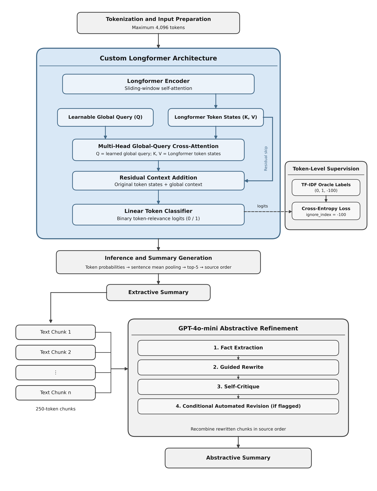

# GroundSum: A Grounded Extraction–Abstraction Framework for Factually Consistent Long-Document Summarization

GroundSum is a research implementation of a two-stage framework for summarizing long scientific documents. It combines **Longformer-based source-content selection** with **GPT-4o-mini-based fact-anchored abstractive refinement**. Experiments use the arXiv and PubMed scientific summarization datasets and compare GroundSum against a DistilBERT–T5 pipeline.

> **Research status:** This repository accompanies the GroundSum research manuscript submitted for publication. The experimental design and reported results below reflect the manuscript. The pipeline is provided to support inspection and reproduction; exact reruns depend on the recorded dataset splits, model configurations, software versions, and GPT API availability. 

## Overview

GroundSum consists of two stages:

1. **Extractive grounding.** A pretrained Longformer encoder processes up to **4,096 input token positions**. A **learnable global-query multi-head cross-attention** module attends over the encoded token representations. The resulting context vector is added to the token states through **residual context fusion**, followed by **binary token-level relevance classification**. Token probabilities are aggregated using **sentence-level mean pooling**; up to five high-scoring sentences are selected and restored to their original source order.
2. **Fact-anchored abstractive refinement.** The extracted summary is divided into chunks of approximately **250 tokens** and refined with GPT-4o-mini using four stages: **fact extraction → guided rewriting → self-critique → conditional revision**. Self-critique flags potentially unsupported phrases, and revision is invoked conditionally when such phrases are flagged. The refined chunks are combined in their original sequence.

DistilBERT is used as a comparative extractive model, and T5 is fine-tuned on DistilBERT-generated extractive predictions to provide the **DistilBERT–T5 abstractive baseline**.

## Project Highlights

- Longformer extractor with learnable global-query cross-attention, residual context fusion, and token-level relevance classification.
- TF-IDF-based supervision construction and sentence-level mean pooling for extractive sentence selection.
- GPT-4o-mini refinement with fact extraction, guided rewriting, self-critique, and conditional revision.
- DistilBERT extractive and DistilBERT–T5 abstractive baselines.
- Experiments on arXiv and PubMed, with ROUGE for extraction and BERTScore plus a **FactCC-inspired GPT-based reference-support score** for abstractive evaluation.

## Overall System Architecture

The extractive stage selects source evidence; the abstractive stage attempts to improve fluency and coherence while limiting unsupported additions. The added global-query cross-attention module is separate from Longformer's built-in sparse self-attention.

<p align="center">
  
</p>

<p align="center"><em>Figure 1. Overall GroundSum architecture.</em></p>

### TF-IDF-Based Token Supervision

For extraction training, TF-IDF scores are used to select up to five salient **source sentences** as extractive reference summaries. These references are constructed from the source sentences rather than by copying the original human-written abstracts.

The token-labeling procedure aligns selected sentence spans with Longformer's tokenizer offset mappings:

- `1`: valid tokens overlapping a TF-IDF-selected reference sentence;
- `0`: other valid source-document tokens;
- `-100`: padding and special tokens, ignored by the cross-entropy loss.

This alignment is applied to the training and validation data. Only source tokens represented in the 4,096-position input window are considered by the Longformer model.

## Repository Structure

```text
GroundSum-code/
├── main.py                  # Pipeline entry point and command-line interface
├── requirements.txt         # Python dependencies
├── README.md                # Documentation
├── .gitignore
├── images/                  # Architecture diagrams
│   ├── architecture.png
│   └── architecture_approach.png
└── src/
    ├── __init__.py
    ├── utils.py             # Configuration, paths, logging, token chunking, I/O
    ├── data_processing.py   # Dataset retrieval, TF-IDF references, oracle BERTScore
    ├── models.py            # Longformer, GPT refinement, DistilBERT, and T5
    └── evaluation.py        # ROUGE, BERTScore, GPT-based reference-support scoring
```

### Module Responsibilities

| Module | Main responsibilities |
|---|---|
| `main.py` | Defines stages and arguments (`--base_dir`, `--stages`, `--datasets`, `--seed`, Longformer and T5 options); coordinates execution. |
| `src/utils.py` | Shared dataset sizes and model parameters; `build_paths`, `setup_logging`, `chunk_by_tokens`, and file I/O utilities. |
| `src/data_processing.py` | `download_datasets`, `load_custom_dataset`, `tfidf_oracle`, `build_enriched_datasets`, and TF-IDF-reference BERTScore evaluation. |
| `src/models.py` | `LongformerWithCrossAttention`, `LongformerExtractor`, `SummaryGenerator`, `SavePretrainedCallback`, `rewrite_with_self_critique`, DistilBERT training, and T5 fine-tuning. |
| `src/evaluation.py` | Extractive ROUGE evaluation; `compute_bertscore`, `compute_factcc_via_gpt`, and `evaluate_all` for rewritten summaries. |

## Datasets and Experimental Splits

GroundSum uses long scientific documents and their original reference summaries from:

- **arXiv:** [nianlong/long-doc-extractive-summarization-arxiv](https://huggingface.co/datasets/nianlong/long-doc-extractive-summarization-arxiv)
- **PubMed:** [nianlong/long-doc-extractive-summarization-pubmed](https://huggingface.co/datasets/nianlong/long-doc-extractive-summarization-pubmed)

The dataset-building stage downloads the JSONL splits, selects the configured subsets, and creates `oracle_summary` annotations using TF-IDF-selected source sentences. Original reference summaries are retained for abstractive evaluation.

### Extractive Summarization

| Split | arXiv | PubMed |
|---|---:|---:|
| Training | 20,000 | 20,000 |
| Validation | 2,500 | 2,500 |
| Test | 2,500 | 2,500 |

These are configured upper limits; fewer records may be retained when inputs are unavailable or filtered. The enriched files are stored under `<base_dir>/dataset/arxiv_enriched/` and `<base_dir>/dataset/pubmed_enriched/`.

### Abstractive Baseline Comparison

For **each dataset**, the initial 2,500-document extractive test subset was further partitioned into **1,500 training**, **500 validation**, and **500 test** documents for the final abstractive comparison:

| Split | Documents per dataset | Purpose |
|---|---:|---|
| Training | 1,500 | Fine-tuning the T5-based baseline |
| Validation | 500 | Validation during T5 training |
| Test | 500 | Final GroundSum versus DistilBERT–T5 comparison |

**The reported final comparison uses the same 500 test documents for both GroundSum and DistilBERT–T5**, as described in the manuscript. The GPT-4o-mini refinement stage is used **without task-specific fine-tuning**.

**Reproducing the exact reported comparison:** Preserve the held-out test document identifiers from the 1,500/500/500 partition and apply the same 500-document selection to both systems' predictions and original dataset reference summaries. The general-purpose `evaluate` command evaluates the GroundSum outputs available in its output directory; its default results should not be mistaken for the separately defined matched-500-document comparison without checking those identifiers.

### Extraction Ablation

A **separate set of 5,000 documents per dataset**, disjoint from the data used for GroundSum training, validation, and testing, was used for the extraction-stage ablation study. Base Longformer and Longformer augmented with **global-query cross-attention and residual context fusion together** were evaluated on the same ablation documents within each corpus. This evaluates the **joint** architectural modification, not the isolated effect of either component.

The general `main.py` CLI does not expose this 5,000-document ablation as a separate named stage. The reported ablation results reflect the experiment described in the manuscript, not an additional output implicitly produced by `--stages all`.

## Setup and Installation

### Prerequisites

- Python **3.10 or later** and sufficient disk space for datasets, checkpoints, and downloaded model weights.
- A CUDA-capable GPU is strongly recommended for 4,096-token Longformer training; runtime and memory requirements depend on the hardware and software environment.
- Internet access to download the datasets and pretrained models.
- An [OpenAI API key](https://platform.openai.com/api-keys) for stages that invoke GPT-4o-mini. **API calls incur usage costs.**

### 1. Clone the repository

```bash
git clone https://github.com/Maryam1104/GroundSum-code.git
cd GroundSum-code
```

### 2. Create an environment

```bash
python -m venv .venv
```

Linux/macOS:

```bash
source .venv/bin/activate
```

Windows PowerShell:

```powershell
.\.venv\Scripts\Activate.ps1
```

### 3. Install dependencies and NLTK resources

```bash
python -m pip install --upgrade pip
python -m pip install -r requirements.txt
python -m nltk.downloader punkt punkt_tab
```

The dependency constraints in `requirements.txt` are **version ranges**, not a frozen environment. Record installed versions (for example, with `python -m pip freeze > environment_freeze.txt`) when reproducing an experiment.

### 4. Set the API key

Linux/macOS:

```bash
export OPENAI_API_KEY="your-api-key"
```

Windows PowerShell:

```powershell
$env:OPENAI_API_KEY="your-api-key"
```

Do not commit API keys or generated credentials to Git.

### 5. Run basic checks

```bash
python -m compileall -q main.py src
python main.py --help
```

These commands check Python syntax and CLI initialization; **they do not validate model training, API calls, data availability, or end-to-end execution**.

## Running the Pipeline

Run commands from the repository root. `--base_dir` controls where datasets, checkpoints, generated summaries, and metrics are written. The default `--datasets` value is `arxiv_enriched`; use `arxiv_enriched,pubmed_enriched` to process both for stages that accept dataset selection.

### All stages (compute- and API-intensive)

```bash
python main.py --base_dir ./project_data --stages all --datasets arxiv_enriched,pubmed_enriched
```

The `all` setting runs, in order: `download`, `build_datasets`, `bertscore_eval`, `longformer`, `baseline_distilbert`, `baseline_t5`, `rewrite`, `evaluate`, and `inspect`. This is an orchestration command, **not a guarantee that every stage will finish on a fresh installation**. It requires suitable hardware, network access, valid dependencies, and API credentials.

### Individual stages

**Download raw dataset files:**

```bash
python main.py --base_dir ./project_data --stages download
```

**Create TF-IDF-enriched JSONL splits:**

```bash
python main.py --base_dir ./project_data --stages build_datasets
```

**Evaluate TF-IDF-selected extractive references with BERTScore:**

```bash
python main.py --base_dir ./project_data --stages bertscore_eval
```

**Train the Longformer extractor and generate extractive summaries:**

```bash
python main.py --base_dir ./project_data --stages longformer --datasets arxiv_enriched,pubmed_enriched
```

The Longformer stage uses `allenai/longformer-base-4096` by default, 4,096 input positions, batch size 1, three training epochs, learning rate `3e-5`, and ROUGE-based validation. `--longformer_model` can select an alternative compatible backbone.

**Train and evaluate DistilBERT extractive baselines:**

```bash
python main.py --base_dir ./project_data --stages baseline_distilbert
```

**Fine-tune the T5 baseline:**

```bash
python main.py --base_dir ./project_data --stages baseline_t5 --datasets arxiv_enriched,pubmed_enriched --t5_model t5-base --t5_max_input_length 32 --t5_max_target_length 32 --t5_epochs 1
```

The CLI defaults reproduce the code's **resource-constrained T5 configuration**: a maximum of 32 input tokens and 32 target tokens, batch size 1, and one epoch. These short lengths truncate longer sequences and should be disclosed when interpreting baseline comparisons. Increasing them defines a different experiment.

**Refine Longformer extractive summaries with GPT-4o-mini:**

```bash
python main.py --base_dir ./project_data --stages rewrite --datasets arxiv_enriched,pubmed_enriched
```

**Evaluate refined summaries:**

```bash
python main.py --base_dir ./project_data --stages evaluate --datasets arxiv_enriched,pubmed_enriched
```

**Inspect prediction files:**

```bash
python main.py --base_dir ./project_data --stages inspect
```

To run only later stages, their prerequisite datasets and generated prediction files must already exist. For example, `baseline_t5` requires the DistilBERT stage's `test_predictions.jsonl` files, whereas `rewrite` requires the Longformer stage's extractive `.txt` files.

## Evaluation Protocol and Interpretation

| Measure | Used for | Important qualification |
|---|---|---|
| ROUGE-1/2/L | Extractive summarization evaluation | Compared against TF-IDF-selected extractive reference summaries. |
| BERTScore (precision/recall/F1) | Semantic similarity of generated and original reference summaries | Semantic alignment does not by itself establish factual correctness. |
| FactCC-inspired GPT-based factual-support score | Reference-based factual support of generated summaries | GPT-4o-mini assesses whether the **original dataset reference summary** supports the generated summary; this is **not the original FactCC model** and does not verify every claim against the complete source article. |

The factual-support evaluator requests `SUPPORTS` or `NOT_SUPPORTS` and a confidence score between 0 and 1; the program averages support-adjusted confidence values. External API responses, library versions, and GPU execution may influence numerical reproducibility.

### Results Reported in the Manuscript

The manuscript reports the following **final abstractive comparison** on the designated 500-document test subsets per corpus:

| Dataset | BERTScore F1: GroundSum | BERTScore F1: DistilBERT–T5 | Factual-support score: GroundSum | Factual-support score: DistilBERT–T5 |
|---|---:|---:|---:|---:|
| PubMed | 0.79 | 0.76 | 0.89 | 0.86 |
| arXiv | 0.79 | 0.74 | 0.97 | 0.81 |

These are the **results reported in the manuscript** for the same held-out 500 documents per corpus. When reproducing them, ensure both systems are evaluated on those exact document identifiers using the manuscript's metric settings. Results can differ across API calls, libraries, and computational environments.

The manuscript also reports a **separate human evaluation of 100 generated summaries** (50 arXiv and 50 PubMed) on faithfulness and relevance. Mean ratings were 3.23/2.37 for arXiv and 2.63/2.11 for PubMed, respectively, on a five-point scale. Different evaluator panels assessed the two datasets, so their ratings should not be treated as directly controlled cross-dataset comparisons. This human evaluation is **not an automated stage** of the repository.

## Key Outputs

Paths below are relative to `<base_dir>`:

| Path | Description |
|---|---|
| `dataset/{arxiv_enriched,pubmed_enriched}/{train,val,test}.jsonl` | TF-IDF-annotated data splits |
| `models/<dataset>/final_model/pytorch_model.bin` | Custom Longformer extractor weights |
| `checkpoints/<dataset>/checkpoint-*/` | Longformer Trainer checkpoints |
| `summaries/<dataset>/<id>.txt` | Extractive summaries |
| `abs_summaries/<dataset>/test_summaries/<id>.txt` | GPT-refined summaries |
| `abs_summaries/<dataset>/evaluation_results.json` | BERTScore and GPT factual-support evaluation |
| `baselines/distilbert/<raw_dataset>/test_predictions.jsonl` | DistilBERT extractive predictions used by T5 |
| `abstractive_t5/<raw_dataset>/metrics/test_metrics.json` | T5 test metrics |
| `abstractive_t5/<raw_dataset>/summaries/test_abstractive.jsonl` | T5-generated test summaries |
| `results/<dataset>_results.csv` | Longformer extractive ROUGE results |
| `logs/main_pipeline.log` | Pipeline log |

Here `<dataset>` is `arxiv_enriched` or `pubmed_enriched`; `<raw_dataset>` is `arxiv` or `pubmed`.

## Reproducibility Notes and Known Scope

- Default seed: `42` (`--seed`); deterministic behavior across hardware and external GPT services is not guaranteed.
- The reported manuscript experiments and the default CLI's general-purpose output selection are distinct: reproduce the manuscript's **same-500-document** final comparison by preserving and applying the held-out document IDs to both systems.
- The 5,000-document-per-dataset ablation uses separate document sets and is not exposed as a standalone CLI stage.
- Syntax and CLI checks do not replace a full end-to-end execution under the intended dependencies, hardware, and API configuration.
- T5's default 32-token inputs/targets are a resource-constrained experimental configuration, not a general long-document T5 setting.
- For a reproducibility report, record Python, CUDA, PyTorch, Transformers, model revisions, API model/version, random seeds, and the exact dataset files and document identifiers.

## Citation

A research manuscript describing GroundSum has been submitted for publication. Formal citation details will be added when available. Until then, refer to this repository by its title and URL:

[GroundSum: A Grounded Extraction–Abstraction Framework for Factually Consistent Long-Document Summarization](https://github.com/Maryam1104/GroundSum-code)

## License

No `LICENSE` file was visible in the public repository at the time of this review. A public GitHub repository is **not automatically open-source licensed**. The authors should add an explicit license if redistribution, modification, or reuse by third parties is intended, and ensure that the license is compatible with dataset and dependency terms.
